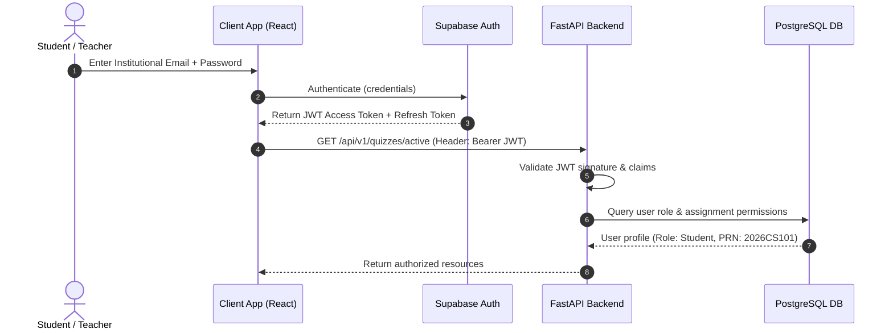
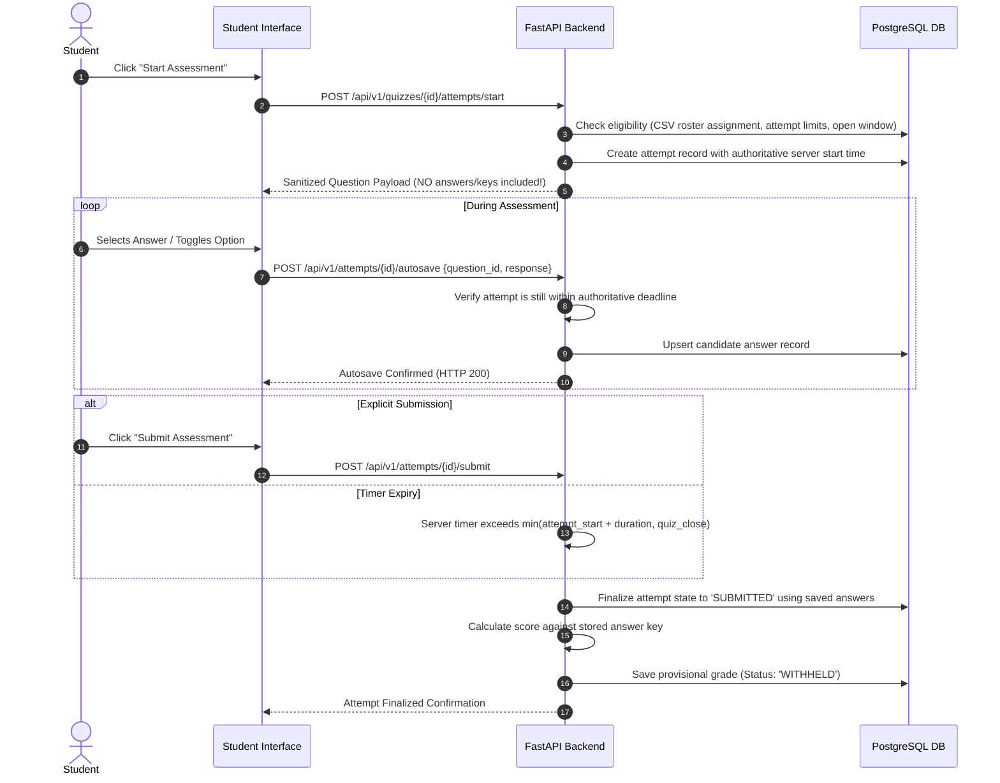
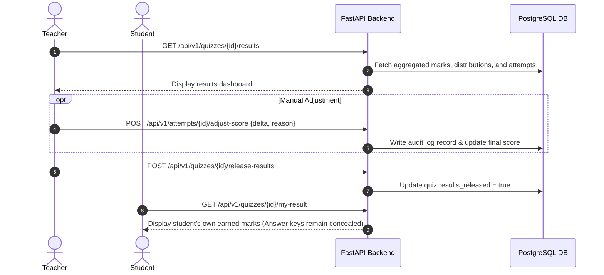

# Architecture Specification

This document defines the high-level system architecture, component boundaries, data flow diagrams, security controls, and technical constraints for **Quizdesk**, an institutional assessment and examination platform.

---

## 1. System Overview

Quizdesk is architected as a **Modular Monolith** designed for high reliability, deterministic transaction handling, and predictable latency during synchronized college examinations. 

Rather than deploying distributed microservices, Quizdesk couples a modern Single-Page Application (SPA) frontend with a unified, high-performance asynchronous Python backend service, backed by managed PostgreSQL and identity services via Supabase.

```
+-----------------------------------------------------------------------------------+
|                                  CLIENT LAYER                                     |
|  +---------------------------------------+  +----------------------------------+  |
|  |       Student Portal (SPA)            |  |       Teacher Portal (SPA)       |  |
|  | - Focused test-taking interface       |  | - Quiz authoring & CSV import    |  |
|  | - Autosave engine & local timer sync  |  | - Roster management & review     |  |
|  | - Result & marks inspection           |  | - Grade adjustments & analytics  |  |
|  +---------------------------------------+  +----------------------------------+  |
|                        React 18+ | TypeScript | Tailwind CSS | Vite               |
+------------------------------------------+----------------------------------------+
                                           | HTTPS / JSON REST APIs
                                           v
+-----------------------------------------------------------------------------------+
|                             BACKEND API LAYER (FastAPI)                           |
|  +-----------------------------------------------------------------------------+  |
|  |                           Security & Auth Middleware                        |  |
|  |  - JWT validation (Supabase Public Key)                                     |  |
|  |  - Role-Based Access Control (RBAC: Student, Teacher, Admin)                |  |
|  |  - Resource ownership & tenant guardrails                                   |  |
|  +-----------------------------------------------------------------------------+  |
|  |                           Modular Domain Services                           |  |
|  |  +------------------+  +------------------+  +---------------------------+  |  |
|  |  |  Auth & Users    |  |  Quiz Engine     |  |  Question Bank & CSV      |  |  |
|  |  +------------------+  +------------------+  +---------------------------+  |  |
|  |  +------------------+  +------------------+  +---------------------------+  |  |
|  |  |  Roster Assign   |  |  Assessment &    |  |  Grading & Review         |  |  |
|  |  |  Management      |  |  Autosave Engine |  |  & Audit Trails           |  |  |
|  |  +------------------+  +------------------+  +---------------------------+  |  |
|  +-----------------------------------------------------------------------------+  |
|  |                    Persistence Layer (SQLAlchemy ORM + Alembic)             |  |
|  +-----------------------------------------------------------------------------+  |
+------------------------------------------+----------------------------------------+
                                           | Connection Pool / Asyncpg
                                           v
+-----------------------------------------------------------------------------------+
|                               PERSISTENCE & IDENTITY                              |
|  +---------------------------------------+  +----------------------------------+  |
|  |       Supabase Auth Service           |  |      PostgreSQL Database         |  |
|  |  - User registration & sign-in        |  |  - Relational schema             |  |
|  |  - Secure password hashing            |  |  - Versioned quizzes             |  |
|  |  - JWT token minting                  |  |  - Immutable audit logs          |  |
|  +---------------------------------------+  +----------------------------------+  |
+-----------------------------------------------------------------------------------+
```

---

## 2. Core Components and Responsibilities

### 2.1 Frontend (React, TypeScript, Vite, Tailwind CSS)
- **Framework**: React 18+ SPA powered by Vite for rapid development and optimized tree-shaken production bundles.
- **Styling**: Tailwind CSS configured with a restrained academic color palette (slate/navy, institutional blue, crisp whites, light greys).
- **Routing**: React Router configured with protected route guards separating student and teacher experiences.
- **State & Autosave**:
  - Local client timers synchronized with authoritative server time via lightweight offset heartbeats.
  - Autosave debouncer that persists student answers reliably in the background without locking UI elements.
  - Resilient session rehydration allowing students to reload or reconnect into an active attempt without losing state.

### 2.2 Backend (Python 3.11+, FastAPI, Pydantic, SQLAlchemy, Alembic)
- **FastAPI**: Asynchronous REST API layer providing high concurrency for simultaneous quiz start and autosave requests.
- **Pydantic (v2)**: Strict schema validation for request payloads, CSV parsing inputs, and response serialization.
- **SQLAlchemy (v2)**: Async ORM mapping relational entities to domain models with explicit connection pooling.
- **Alembic**: Incremental, version-controlled database migrations preventing drift across environments.

### 2.3 Database & Auth (PostgreSQL via Supabase)
- **PostgreSQL**: Relational storage enforcing foreign key constraints, unique indexing (e.g., student PRN and student email per quiz), database check constraints on marks and schedules, and transactional ACID guarantees during quiz submissions.
- **Code-First Schema & Alembic**: 13 domain models managed via SQLAlchemy 2.x declarative Base (`users`, `student_profiles`, `quizzes`, `quiz_versions`, `questions`, `question_options`, `quiz_assignments`, `quiz_attempts`, `attempt_answers`, `attempt_telemetry_events`, `grade_adjustments`, `audit_events`, `import_jobs`). All DDL operations execute via version-controlled migrations (`backend/alembic/`), never manual dashboard edits.
  - *Immutability Protection*: `QuizVersion` enforces `ON DELETE RESTRICT` from `quizzes`, preventing accidental deletion of version snapshots and completed attempts. Assessments must be archived, not hard-deleted.
  - *Result Visibility Gate*: `QuizVersion.is_results_released` is the sole authoritative gate controlling student visibility into scores and answer keys. `QuizAttempt.grading_status` (`pending`, `auto_graded`, `manually_adjusted`) manages the internal scoring lifecycle and audit trail.
- **Supabase Auth**: Managed authentication handling institutional email/password sign-ins, JWT issuance, and secure credential handling.


---

## 3. Data Flow Diagrams

### 3.1 Authentication & Request Authorization


### 3.2 Quiz Authoring & Versioning
```mermaid
sequenceDiagram
    autonumber
    actor Teacher
    participant API as FastAPI Backend
    participant DB as PostgreSQL DB

    Teacher->>API: Upload Question CSV / Manual Form
    API->>API: Validate schema & syntax; generate validation preview
    API-->>Teacher: Display preview & detected errors
    Teacher->>API: Confirm & Create Quiz Draft
    Teacher->>API: Publish Quiz
    API->>DB: Mark Quiz as Published (Version 1, Immutable)
    Note over API,DB: Subsequent edits create Version 2 without altering active attempts.
```

### 3.3 Student Assessment Delivery & Autosave Flow


### 3.4 Teacher Review & Result Release Flow


---

## 4. Security Boundaries and Controls

1. **Server-Authoritative Timing and Evaluation**:
   - The server maintains the true clock. Client-side timers exist only to render visual countdowns.
   - Any autosave or final submission request received after the calculated deadline is rejected for scoring.
2. **Answer Secrecy in Transit**:
   - Delivery payloads to students strictly omit `is_correct`, `answer_key`, and `explanation` attributes.
   - Questions are shuffled on the server per attempt when randomization is configured.
3. **Role & Resource Ownership Boundaries**:
   - Students cannot view other students' attempts, grades, or personal details.
   - Only teachers assigned to a course or institutional administrators can manage quiz configurations or inspect class-wide grades.
   - PRN is an academic identifier, not a credential or token.
4. **Auditability & Traceability**:
   - Tab-switching and proctoring events are recorded as telemetry metadata and validated transactionally on the backend (DEC-021).
5. **Hardened Assessment Integrity & Configurable Proctoring (DEC-021)**:
   - **Teacher-Configurable Policy**: Free violation allowance ($F$), deduction rate ($D$, supporting half marks e.g. 0.5), and cumulative maximum deduction cap ($C$) configured per quiz version.
   - **Bounded Scoring Formula**:
     $$\text{chargeable\_violations} = \max(0, V - F)$$
     $$\text{proctoring\_deduction} = \min(\text{chargeable\_violations} \times D, C, \max(0, S))$$
     $$\text{final\_score} = \max(0, S - \text{proctoring\_deduction})$$
     Ensures deductions never exceed the cumulative cap or the student's earned raw score, strictly guaranteeing non-negative results ($S \ge 0$).
   - **Telemetry Invariants & Idempotency**:
     - Client sends unique `client_event_id` with every event, preventing retry duplicates.
     - Paired `window_blur` and `tab_switch` browser signals within 1000ms are deduplicated on the server.
     - Rejection of invalid, unsupported, or deceptive telemetry (e.g., fake screenshot signals). No simulated or unverified OS-level detection claims.
   - **Pre-Quiz Assessment Readiness Screen**:
     - Mandatory review of proctoring policies, attempt limits, navigation constraints, and penalties.
     - Automated browser capability verification, Fullscreen API support check, and server connectivity validation.
     - Fullscreen mode initiated exclusively in response to explicit student confirmation.
   - **In-Assessment Deterrents & Transparency**:
     - Assessment-scoped prevention of copy, cut, paste, and context menu.
     - Fullscreen exit listeners trigger immediate top banners prompting return to fullscreen.
     - Live violation indicator displays accepted count, remaining free quota, and cumulative penalty deductions.
   - **Audit & Teacher Diagnostics**:
     - Attempt details provide breakdown by event category, effective policy snapshot, and timestamped event history.
6. **Zero-Trust Network Operations**:
   - Passwords and service keys are never returned in API payloads or logged in debug output.
   - Database connection pools use encrypted TLS connections.
7. **Authoritative Application Role Verification**:
   - Authentication tokens issued by Supabase cryptographically verify identity (`sub` claim), but never grant application permissions directly.
   - User roles (`student`, `teacher`, `admin`) are strictly resolved from the application database table (`users.role`).
   - Role claims or user metadata embedded in the JWT payload or request body are completely untrusted and ignored for authorization.


---

## 5. Technical Constraints

- **Modular Monolith**: No separate microservice deployments. Domain modules communicate via in-process service layers and typed interfaces.
- **Python Environment**: Dependencies must run strictly within an isolated project virtual environment (`.venv`).
- **No Direct Frontend Database Access**: Even though Supabase supports direct client-side querying, all business operations (starting attempts, saving answers, calculating scores, releasing results) **must** transit through the FastAPI backend to enforce business logic and audit integrity.
- **Concurrency Resilience**: Database indexes must be strategically created on `(quiz_id, student_prn)`, `(attempt_id, question_id)`, and `(user_id, quiz_id)` to handle simultaneous assessment starts without deadlocks.

---

## 6. Planned Repository Directory Layout

```
Quizdesk/
|-- AGENTS.md                  # Authoritative instructions for AI coding sessions
|-- docs/                      # Persistent project memory and specifications
|   |-- PROJECT_LOG.md         # Chronological project log, status, and command history
|   |-- DECISIONS.md           # Architecture Decision Records (ADRs)
|   |-- TASK_TRACKER.md        # Roadmap, task breakdown, and acceptance criteria
|   `-- ARCHITECTURE.md        # System design, data flows, and security constraints
|
|-- backend/                   # Python FastAPI service (To be scaffolded)
|   |-- app/
|   |   |-- api/               # API router endpoints (v1)
|   |   |-- core/              # Config, security, database session
|   |   |-- domains/           # Modular domain services:
|   |   |   |-- auth/          # User identity, JWT verification, roles
|   |   |   |-- quizzes/       # Quiz lifecycle, versions, scheduling
|   |   |   |-- questions/     # Question models, CSV parsers, validation
|   |   |   |-- roster/        # Student CSV assignments & eligibility
|   |   |   |-- attempts/      # Active assessment engine, autosave, timers
|   |   |   `-- results/       # Evaluation, review, release, audit logs
|   |   `-- models/            # SQLAlchemy declarative models
|   |-- alembic/               # Database migrations
|   |-- tests/                 # Backend test suite (pytest, httpx)
|   `-- pyproject.toml         # Dependencies and tool configurations
|
|-- frontend/                  # React + TypeScript + Vite SPA (To be scaffolded)
|   |-- src/
|   |   |-- components/        # Shared accessible UI components
|   |   |-- pages/             # Student, teacher, and assessment views
|   |   |-- hooks/             # Autosave, timer sync, auth hooks
|   |   |-- services/          # Typed API clients
|   |   |-- types/             # Domain TypeScript contracts
|   |   `-- App.tsx            # Routes and layout providers
|   |-- tests/                 # Frontend unit tests (Vitest, RTL)
|   |-- tailwind.config.js     # Institutional minimalist design tokens
|   `-- package.json           # Dependencies and scripts
|
`-- e2e/                       # End-to-end integration tests (Playwright)
```

---

## 7. Administrative Operational Architecture & Guarded Reset Safeguards (Phase 8B)

### 7.1 Separate Portal Entry Routes & Navigation Isolation
The application maintains clear architectural separation between student and operational roles:
- `/student/login`: Student Examination Portal entry. Points exclusively to `/student/portal`. Contains zero administrative or faculty navigation links.
- `/teacher/login`: Faculty Assessment Portal entry with password recovery flow (`/teacher/forgot-password`). Points to `/teacher/quizzes`.
- `/admin/login`: Restricted Operational Admin Portal entry with single administrator bootstrapping.
- Client navigation shells (`Shell.tsx`, `Header.tsx`) render menu links strictly conditional on authoritative backend roles (`UserRole.ADMIN`, `UserRole.TEACHER`, `UserRole.STUDENT`).
- Backend security boundary: Hidden client links are not a security mechanism. All endpoints mounted under `/api/v1/admin/*` mandate `require_admin` dependency; unauthenticated requests receive HTTP 401 and unauthorized roles receive HTTP 403.

### 7.2 Server-Authoritative Administrator Provisioning
- The initial administrator identity is configured strictly via server environment variables (`ADMIN_EMAIL`, `ADMIN_NAME`, `ADMIN_BOOTSTRAP_TOKEN`).
- Initial provisioning endpoint `POST /api/v1/admin/bootstrap`:
  1. Validates the incoming Supabase JWT token.
  2. Confirms `token.email.lower() == settings.ADMIN_EMAIL.lower()`.
  3. Verifies `bootstrap_token == settings.ADMIN_BOOTSTRAP_TOKEN` if configured.
  4. Upserts the record in `users` with `role = UserRole.ADMIN` and `is_active = True`.
  5. Records an immutable `admin.bootstrap_provisioned` audit event.
- Client metadata and self-signup requests are strictly untrusted and cannot grant administrative privileges.

### 7.3 Guarded Test-Data Reset Safeguards
To support reproducible development and QA rehearsal without endangering production data, the reset endpoint (`POST /api/v1/admin/reset-test-data`) enforces 7 consecutive security safeguards:
1. **Disabled by default**: Gated by `settings.ALLOW_DESTRUCTIVE_RESET` (default `False`).
2. **Blocked in production**: Rejects execution if `settings.ENVIRONMENT.lower() == "production"` with HTTP 403 Forbidden.
3. **Role enforcement**: Requires authenticated user with `UserRole.ADMIN`.
4. **Mandatory confirmation code**: Request body must provide explicit token `CONFIRM_DELETE_ALL_TEST_DATA`; any variation returns HTTP 400 Bad Request.
5. **Transactional dependency ordering**: Executed inside a single atomic database transaction in foreign-key dependency order:
   $$\text{AttemptAnswer} \rightarrow \text{AttemptTelemetryEvent} \rightarrow \text{GradeAdjustment} \rightarrow \text{QuizAttempt} \rightarrow \text{QuizAssignment} \rightarrow \text{ImportJob} \rightarrow \text{QuestionOption} \rightarrow \text{Question} \rightarrow \text{QuizVersion} \rightarrow \text{Quiz}$$
6. **Account & Audit preservation**: User accounts (`User`) and audit history (`AuditEvent`) are strictly preserved.
7. **Audit trail generation**: Writes a tamper-evident audit record documenting the environment, cleared record counts, and administrator identity.

### 7.4 Cross-Teacher Roster Enrollment & Assignment Isolation
- Roster records (`QuizAssignment`) are uniquely scoped per quiz: compound unique constraints `(quiz_id, student_prn)` and `(quiz_id, student_email)`.
- Global enrollment is non-exclusive: Teacher A assigning Student X to Quiz A does not block Teacher B assigning Student X to Quiz B.
- Same-quiz duplicate uploads are handled idempotently, updating metadata without creating duplicate assignment entities.
- String preservation: PRNs are stored as strings (`String(64)`), strictly preserving leading zeros.
- Mismatches between student account PRNs and roster rows are flagged as identity conflicts and rejected with HTTP 422 Unprocessable Entity.

---

## 8. Production Readiness, Health Probes, and Concurrency Architecture (Phase 9)

### 8.1 Health & Readiness Probes
The backend exposes two standard probes for orchestration (Kubernetes, AWS ECS, Docker Compose) and reverse proxies (Caddy, Nginx):
- **Liveness Probe (`GET /health/live`)**: Returns `{"status": "alive"}` immediately with HTTP 200 without touching external dependencies. Verifies event loop and worker process health.
- **Readiness Probe (`GET /health/ready`)**: Performs an active `SELECT 1` query against the database connection pool.
  - On success: Returns HTTP 200 `{"status": "ready", "database": "connected"}`.
  - On pool exhaustion or database disconnection: Returns HTTP 503 `{"status": "unhealthy", "database": "disconnected"}`. Traffic is automatically diverted from unready instances.

### 8.2 Database Connection Pool Calibration for Supabase Poolers
When connecting via Supabase Session Pooler (`port 5432` / Supavisor), upstream client connections are constrained (15 max on free tier).
To prevent `EMAXCONNSESSION` connection exhaustion while serving 50+ concurrent student sessions, SQLAlchemy's `QueuePool` is configured as follows:
- `DB_POOL_SIZE = 8`
- `DB_MAX_OVERFLOW = 4`
- `DB_POOL_TIMEOUT = 30` (seconds)
- `DB_POOL_RECYCLE = 1800` (seconds, recycling stale connections before pooler timeouts)
FastAPI's asynchronous I/O allows Python coroutines to yield database connections back into the local `QueuePool` during answer formatting, token parsing, and network transmission, achieving 50+ concurrent student operations with zero connection leakage.

### 8.3 Concurrency & Load Testing Architecture
Quizdesk includes an in-tree load testing framework located at `backend/load_tests/`:
- **`runner.py`**: Standalone asynchronous load tester using `httpx.AsyncClient` with an `asyncio.Event` synchronization barrier to model synchronized exam starts.
- **`locustfile.py`**: Turnkey Locust user simulation file for distributed load testing.
- **Transactional Invariant Audit**: Automatically verifies post-run invariants in PostgreSQL:
  1. `count(quiz_attempts) == target_students` (Zero duplicate attempts)
  2. `count(attempt_answers) == target_students * questions_per_quiz` (Zero lost answers)
  3. `0 <= score <= total_points` across all finalized attempts
  4. Proctoring telemetry idempotency: duplicate telemetry submissions produce zero extra penalty deductions.

