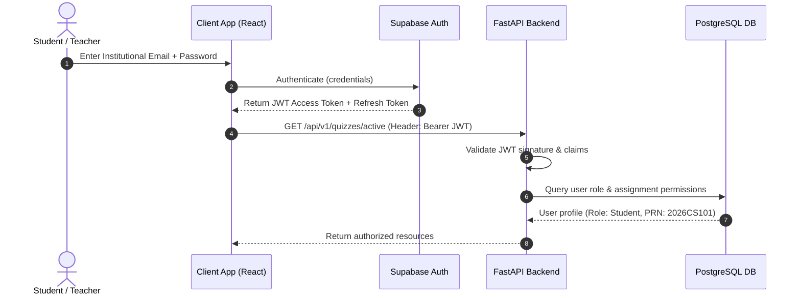
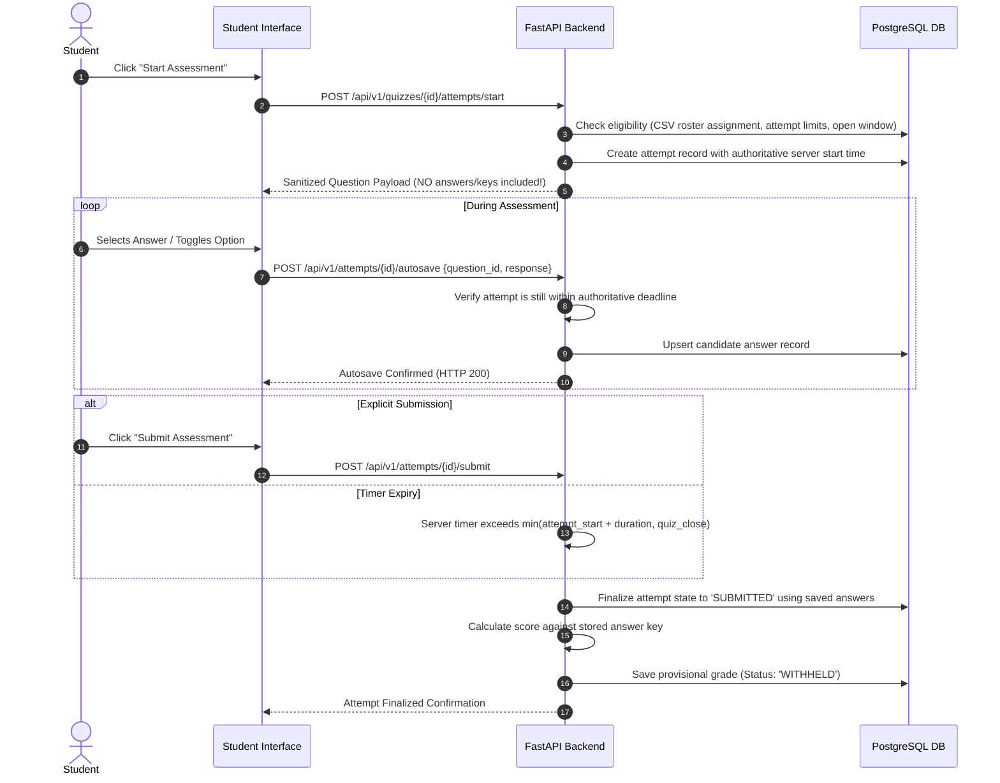
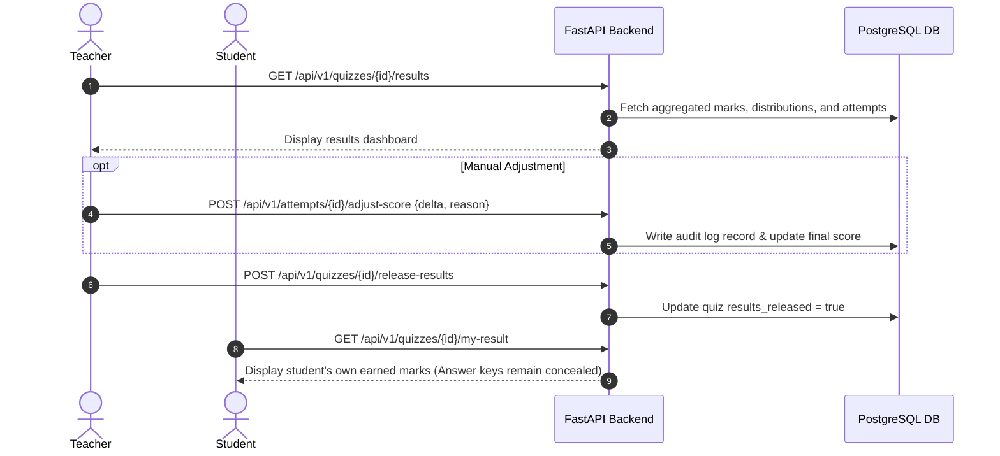

# Architecture Specification

This document defines the high-level system architecture, component boundaries, data flow diagrams, security controls, and technical constraints for **Quizdesk**, an institutional assessment and examination platform.

---

## 1. System Overview

Quizdesk is architected as a **Modular Monolith** designed for high reliability, deterministic transaction handling, and predictable latency during synchronized college examinations. 

Rather than deploying distributed microservices, Quizdesk couples a modern Single-Page Application (SPA) frontend with a unified, high-performance asynchronous Python backend service, backed by managed PostgreSQL and identity services via Supabase.

```
+-----------------------------------------------------------------------------------+
|                                  CLIENT LAYER                                     |
|  +---------------------------------------+  +----------------------------------+  |
|  |       Student Portal (SPA)            |  |       Teacher Portal (SPA)       |  |
|  | - Focused test-taking interface       |  | - Quiz authoring & CSV import    |  |
|  | - Autosave engine & local timer sync  |  | - Roster management & review     |  |
|  | - Result & marks inspection           |  | - Grade adjustments & analytics  |  |
|  +---------------------------------------+  +----------------------------------+  |
|                        React 18+ | TypeScript | Tailwind CSS | Vite               |
+------------------------------------------+----------------------------------------+
                                           | HTTPS / JSON REST APIs
                                           v
+-----------------------------------------------------------------------------------+
|                             BACKEND API LAYER (FastAPI)                           |
|  +-----------------------------------------------------------------------------+  |
|  |                           Security & Auth Middleware                        |  |
|  |  - JWT validation (Supabase Public Key)                                     |  |
|  |  - Role-Based Access Control (RBAC: Student, Teacher, Admin)                |  |
|  |  - Resource ownership & tenant guardrails                                   |  |
|  +-----------------------------------------------------------------------------+  |
|  |                           Modular Domain Services                           |  |
|  |  +------------------+  +------------------+  +---------------------------+  |  |
|  |  |  Auth & Users    |  |  Quiz Engine     |  |  Question Bank & CSV      |  |  |
|  |  +------------------+  +------------------+  +---------------------------+  |  |
|  |  +------------------+  +------------------+  +---------------------------+  |  |
|  |  |  Roster Assign   |  |  Assessment &    |  |  Grading & Review         |  |  |
|  |  |  Management      |  |  Autosave Engine |  |  & Audit Trails           |  |  |
|  |  +------------------+  +------------------+  +---------------------------+  |  |
|  +-----------------------------------------------------------------------------+  |
|  |                    Persistence Layer (SQLAlchemy ORM + Alembic)             |  |
|  +-----------------------------------------------------------------------------+  |
+------------------------------------------+----------------------------------------+
                                           | Connection Pool / Asyncpg
                                           v
+-----------------------------------------------------------------------------------+
|                               PERSISTENCE & IDENTITY                              |
|  +---------------------------------------+  +----------------------------------+  |
|  |       Supabase Auth Service           |  |      PostgreSQL Database         |  |
|  |  - User registration & sign-in        |  |  - Relational schema             |  |
|  |  - Secure password hashing            |  |  - Versioned quizzes             |  |
|  |  - JWT token minting                  |  |  - Immutable audit logs          |  |
|  +---------------------------------------+  +----------------------------------+  |
+-----------------------------------------------------------------------------------+
```

---

## 2. Core Components and Responsibilities

### 2.1 Frontend (React, TypeScript, Vite, Tailwind CSS)
- **Framework**: React 18+ SPA powered by Vite for rapid development and optimized tree-shaken production bundles.
- **Styling**: Tailwind CSS configured with a restrained academic color palette (slate/navy, institutional blue, crisp whites, light greys).
- **Routing**: React Router configured with protected route guards separating student and teacher experiences.
- **State & Autosave**:
  - Local client timers synchronized with authoritative server time via lightweight offset heartbeats.
  - Autosave debouncer that persists student answers reliably in the background without locking UI elements.
  - Resilient session rehydration allowing students to reload or reconnect into an active attempt without losing state.

### 2.2 Backend (Python 3.11+, FastAPI, Pydantic, SQLAlchemy, Alembic)
- **FastAPI**: Asynchronous REST API layer providing high concurrency for simultaneous quiz start and autosave requests.
- **Pydantic (v2)**: Strict schema validation for request payloads, CSV parsing inputs, and response serialization.
- **SQLAlchemy (v2)**: Async ORM mapping relational entities to domain models with explicit connection pooling.
- **Alembic**: Incremental, version-controlled database migrations preventing drift across environments.

### 2.3 Database & Auth (PostgreSQL via Supabase)
- **PostgreSQL**: Relational storage enforcing foreign key constraints, unique indexing (e.g., student assignments), and transactional ACID guarantees during quiz submissions.
- **Code-First Schema & Alembic**: 13 domain models managed via SQLAlchemy 2.x declarative Base (`users`, `student_profiles`, `quizzes`, `quiz_versions`, `questions`, `question_options`, `quiz_assignments`, `quiz_attempts`, `attempt_answers`, `attempt_telemetry_events`, `grade_adjustments`, `audit_events`, `import_jobs`). All DDL operations execute via version-controlled migrations (`backend/alembic/`), never manual dashboard edits.
- **Supabase Auth**: Managed authentication handling institutional email/password sign-ins, JWT issuance, and secure credential handling.


---

## 3. Data Flow Diagrams

### 3.1 Authentication & Request Authorization


### 3.2 Quiz Authoring & Versioning
```mermaid
sequenceDiagram
    autonumber
    actor Teacher
    participant API as FastAPI Backend
    participant DB as PostgreSQL DB

    Teacher->>API: Upload Question CSV / Manual Form
    API->>API: Validate schema & syntax; generate validation preview
    API-->>Teacher: Display preview & detected errors
    Teacher->>API: Confirm & Create Quiz Draft
    Teacher->>API: Publish Quiz
    API->>DB: Mark Quiz as Published (Version 1, Immutable)
    Note over API,DB: Subsequent edits create Version 2 without altering active attempts.
```

### 3.3 Student Assessment Delivery & Autosave Flow


### 3.4 Teacher Review & Result Release Flow


---

## 4. Security Boundaries and Controls

1. **Server-Authoritative Timing and Evaluation**:
   - The server maintains the true clock. Client-side timers exist only to render visual countdowns.
   - Any autosave or final submission request received after the calculated deadline is rejected for scoring.
2. **Answer Secrecy in Transit**:
   - Delivery payloads to students strictly omit `is_correct`, `answer_key`, and `explanation` attributes.
   - Questions are shuffled on the server per attempt when randomization is configured.
3. **Role & Resource Ownership Boundaries**:
   - Students cannot view other students' attempts, grades, or personal details.
   - Only teachers assigned to a course or institutional administrators can manage quiz configurations or inspect class-wide grades.
   - PRN is an academic identifier, not a credential or token.
4. **Auditability & Traceability**:
   - Any modification to scores post-submission generates an unalterable audit log entry containing `adjusted_by`, `old_score`, `new_score`, `reason`, and `timestamp`.
   - Tab-switching events are recorded as telemetry metadata, giving teachers objective context without triggering opaque automated penalties.
5. **Zero-Trust Network Operations**:
   - Passwords and service keys are never returned in API payloads or logged in debug output.
   - Database connection pools use encrypted TLS connections.

---

## 5. Technical Constraints

- **Modular Monolith**: No separate microservice deployments. Domain modules communicate via in-process service layers and typed interfaces.
- **Python Environment**: Dependencies must run strictly within an isolated project virtual environment (`.venv`).
- **No Direct Frontend Database Access**: Even though Supabase supports direct client-side querying, all business operations (starting attempts, saving answers, calculating scores, releasing results) **must** transit through the FastAPI backend to enforce business logic and audit integrity.
- **Concurrency Resilience**: Database indexes must be strategically created on `(quiz_id, student_prn)`, `(attempt_id, question_id)`, and `(user_id, quiz_id)` to handle simultaneous assessment starts without deadlocks.

---

## 6. Planned Repository Directory Layout

```
Quizdesk/
|-- AGENTS.md                  # Authoritative instructions for AI coding sessions
|-- docs/                      # Persistent project memory and specifications
|   |-- PROJECT_LOG.md         # Chronological project log, status, and command history
|   |-- DECISIONS.md           # Architecture Decision Records (ADRs)
|   |-- TASK_TRACKER.md        # Roadmap, task breakdown, and acceptance criteria
|   `-- ARCHITECTURE.md        # System design, data flows, and security constraints
|
|-- backend/                   # Python FastAPI service (To be scaffolded)
|   |-- app/
|   |   |-- api/               # API router endpoints (v1)
|   |   |-- core/              # Config, security, database session
|   |   |-- domains/           # Modular domain services:
|   |   |   |-- auth/          # User identity, JWT verification, roles
|   |   |   |-- quizzes/       # Quiz lifecycle, versions, scheduling
|   |   |   |-- questions/     # Question models, CSV parsers, validation
|   |   |   |-- roster/        # Student CSV assignments & eligibility
|   |   |   |-- attempts/      # Active assessment engine, autosave, timers
|   |   |   `-- results/       # Evaluation, review, release, audit logs
|   |   `-- models/            # SQLAlchemy declarative models
|   |-- alembic/               # Database migrations
|   |-- tests/                 # Backend test suite (pytest, httpx)
|   `-- pyproject.toml         # Dependencies and tool configurations
|
|-- frontend/                  # React + TypeScript + Vite SPA (To be scaffolded)
|   |-- src/
|   |   |-- components/        # Shared accessible UI components
|   |   |-- pages/             # Student, teacher, and assessment views
|   |   |-- hooks/             # Autosave, timer sync, auth hooks
|   |   |-- services/          # Typed API clients
|   |   |-- types/             # Domain TypeScript contracts
|   |   `-- App.tsx            # Routes and layout providers
|   |-- tests/                 # Frontend unit tests (Vitest, RTL)
|   |-- tailwind.config.js     # Institutional minimalist design tokens
|   `-- package.json           # Dependencies and scripts
|
`-- e2e/                       # End-to-end integration tests (Playwright)
```
